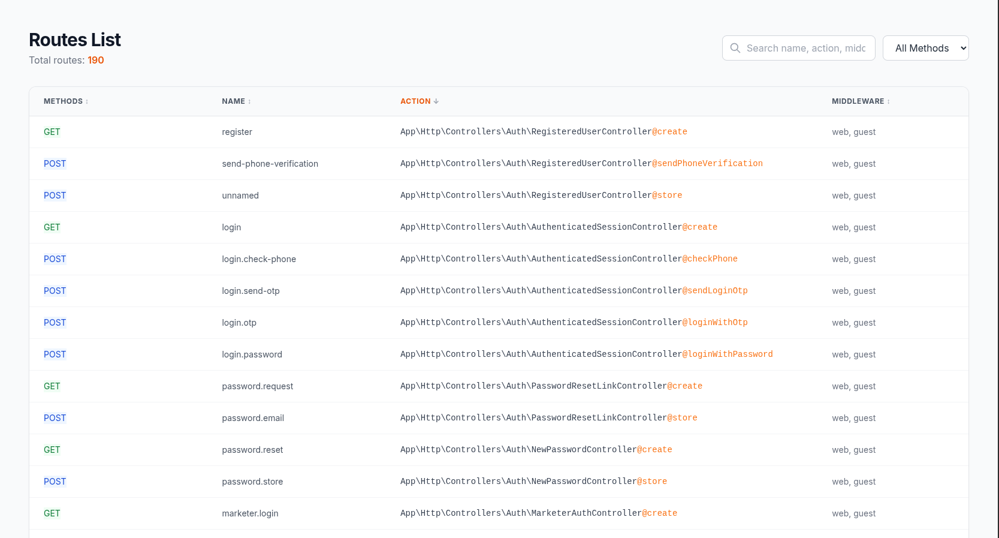

# Cute Routes for Laravel

<p align="center">
  <a href="https://packagist.org/packages/nrzamirho3in/cute-routes">
    
  </a>
  <a href="https://packagist.org/packages/nrzamirho3in/cute-routes">
    
  </a>
  <a href="https://packagist.org/packages/nrzamirho3in/cute-routes">
    
  </a>
  <a href="https://laravel.com">
    
  </a>
</p>

<p align="center">
  
</p>

A beautiful, modern route viewer for Laravel applications. Visualize all your application routes in a clean, searchable, and filterable interface built with **Tailwind CSS**.

## ✨ Features

- 🎨 **Modern UI** — Clean, responsive design powered by Tailwind CSS
- 🔍 **Real-time Search** — Instantly filter routes by name, action, or middleware
- 🏷️ **HTTP Method Filters** — Filter routes by GET, POST, PUT, PATCH, DELETE, etc.
- ↕️ **Sortable Columns** — Click any column header to sort
- 🎯 **Color-coded Methods** — Each HTTP method has its own distinct color
- ⚙️ **Highly Configurable** — Customize URL, middlewares, and visibility rules
- 🔒 **Debug-safe** — Automatically disabled in production (configurable)
- 🚀 **Zero Configuration** — Works out of the box with Laravel's auto-discovery

## 📋 Requirements

- PHP `^8.0`
- Laravel `^9.0 | ^10.0 | ^11.0 | ^12.0 | ^13.0`

## 📦 Installation

Install the package via Composer:

```bash
composer require nrzamirho3in/cute-routes
```

If you're using Laravel's auto-discovery (Laravel 5.5+), you're all set!

Otherwise, manually add the service provider to your `config/app.php`:

```php
'providers' => [
    // ...
    CuteRoutes\ServiceProvider::class,
],
```

## 🚀 Usage

Once installed, simply visit:

```
http://your-app.local/routes
```

And you'll see a beautiful list of all your application routes.

> 💡 **Note:** By default, the viewer is only accessible when `APP_DEBUG=true` in your `.env` file.

## ⚙️ Configuration

Publish the configuration file to customize the package:

```bash
php artisan vendor:publish --provider="CuteRoutes\ServiceProvider"
```

This will create a `config/cute-routes.php` file. Available options:

```php
return [
    // The URL endpoint to access the routes viewer
    'url' => 'routes',

    // Middleware(s) applied to the routes page
    'middlewares' => [],

    // Only enable when APP_DEBUG is true
    'debug_only' => true,

    // HTTP methods to hide from the list
    'hide_methods' => ['HEAD'],

    // Hide routes matching these regex patterns
    'hide_matching' => [
        '#^_debugbar#',
        '#^_ignition#',
        '#^routes$#',
    ],
];
```

### 🔐 Protecting in Production

If you want to enable the viewer in production (not recommended), set `debug_only` to `false` and protect it with middleware:

```php
'middlewares' => ['auth', 'admin'],
```

## 🎨 Preview

| Feature | Description |
|---------|-------------|
| 🔍 Search | Filter by route name, controller action, or middleware |
| 🎯 Method Badges | Color-coded badges for GET, POST, PUT, PATCH, DELETE |
| ↕️ Sorting | Click column headers to sort ascending/descending |
| 📱 Responsive | Works perfectly on desktop, tablet, and mobile |

## 🤝 Contributing

Contributions are welcome! Feel free to open an issue or submit a pull request on [GitHub](https://github.com/nrzAmirHo3in/cute-routes).

## 📄 License

This package is open-sourced software licensed under the [MIT license](LICENSE).

## 🙏 Credits

- Inspired by [garygreen/pretty-routes](https://github.com/garygreen/pretty-routes)
- UI redesigned and modernized by [Amirhossein](https://github.com/nrzAmirHo3in)
- Built with ❤️ using [Tailwind CSS](https://tailwindcss.com)

---

<p align="center">
  <b>If you find this package useful, please consider giving it a ⭐ on GitHub!</b>
</p>
